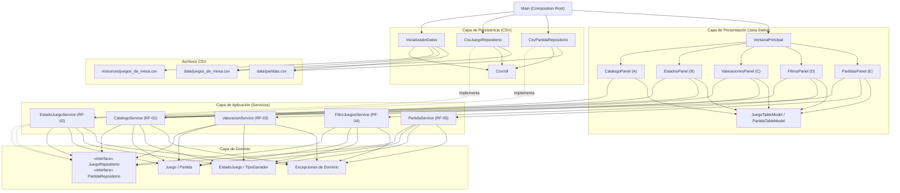
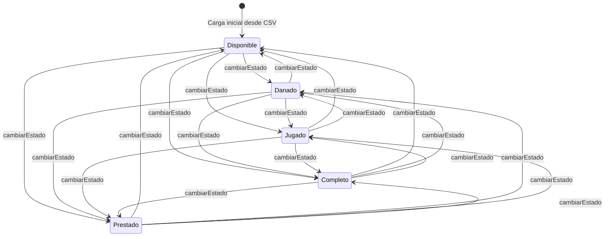

# Arquitectura y Diagramas — Gestión de Juegos de Mesa

## 1. Arquitectura por capas

El sistema sigue una **arquitectura en cuatro capas** combinada con el **Principio de Inversión de Dependencias (DIP)**: las interfaces de repositorio se definen en el dominio y son implementadas por la capa de persistencia.

| Capa | Paquete | Responsabilidad |
| :--- | :--- | :--- |
| **Presentación** | `es.uv.is2.juegos.presentacion` | Ventana principal, paneles Swing y modelos de tabla. Captura eventos de usuario, valida formato de entrada de formularios y delega toda operación en los servicios de aplicación. |
| **Aplicación** | `es.uv.is2.juegos.aplicacion` | Casos de uso del sistema organizados en 5 servicios independientes (`CatalogoService`, `EstadoJuegoService`, `ValoracionService`, `FiltroJuegosService`, `PartidaService`). |
| **Dominio** | `es.uv.is2.juegos.dominio` | Entidades (`Juego`, `Partida`), enumeraciones (`EstadoJuego`, `TipoGanador`), excepciones de negocio e interfaces de repositorio (`JuegoRepositorio`, `PartidaRepositorio`). |
| **Persistencia** | `es.uv.is2.juegos.persistencia` | Lectura/escritura segura de CSV (`CsvUtil`, `CsvJuegoRepositorio`, `CsvPartidaRepositorio`) e inicialización no destructiva del catálogo (`InicializadorDatos`). |

### Reglas de dependencia

- `Presentación` → `Aplicación` (y tipos de datos/excepciones de `Dominio`).
- `Aplicación` → `Dominio` (incluyendo las interfaces de repositorio).
- `Persistencia` → `Dominio` (implementa las interfaces de repositorio).
- `Dominio` → **sin dependencias** sobre ninguna otra capa.
- `Main` actúa únicamente como *Composition Root* (raíz de composición) que instancia repositorios, servicios y la ventana principal.

---

## 2. Diagrama de componentes

---

## 3. Diagrama de clases

```mermaid
classDiagram
    class EstadoJuego {
        <<enumeration>>
        DISPONIBLE
        DANADO
        JUGADO
        COMPLETO
        PRESTADO
        +getEtiqueta() String
        +fromTexto(String) EstadoJuego
    }

    class TipoGanador {
        <<enumeration>>
        INDIVIDUAL
        EQUIPO
        +getEtiqueta() String
        +fromTexto(String) TipoGanador
    }

    class Juego {
        -int id
        -String titulo
        -String editorial
        -int anioLanzamiento
        -int minJugadores
        -int maxJugadores
        -int duracionMinima
        -int duracionMaxima
        -EstadoJuego estado
        -Integer valoracion
        +setEstado(EstadoJuego) void
        +setValoracion(Integer) void
        +eliminarValoracion() void
        +getDuracionFormateada() String
        +getJugadoresFormateados() String
        +validarNumeroParticipantes(int) void
    }

    class Partida {
        -int id
        -int juegoId
        -int numeroParticipantes
        -String ganador
        -TipoGanador tipoGanador
        -LocalDate fecha
        +tuvoGanador() boolean
    }

    class JuegoRepositorio {
        <<interface>>
        +obtenerTodos() List~Juego~
        +buscarPorId(int) Optional~Juego~
        +buscarPorTituloExacto(String) List~Juego~
        +actualizar(Juego) void
        +guardarTodos(List~Juego~) void
    }

    class PartidaRepositorio {
        <<interface>>
        +obtenerTodas() List~Partida~
        +buscarPorJuegoId(int) List~Partida~
        +guardar(Partida) Partida
        +obtenerSiguienteId() int
    }

    class CsvJuegoRepositorio
    class CsvPartidaRepositorio
    class InicializadorDatos

    class CatalogoService {
        +listarCatalogo() List~Juego~
        +obtenerPorId(int) Juego
        +buscarPorNombreExacto(String) List~Juego~
    }

    class EstadoJuegoService {
        +consultarEstado(int) EstadoJuego
        +cambiarEstado(int, EstadoJuego) Juego
    }

    class ValoracionService {
        +asignarValoracion(int, int) Juego
        +modificarValoracion(int, int) Juego
        +eliminarValoracion(int) Juego
    }

    class FiltroJuegosService {
        +filtrarPorNombre(String) List~Juego~
        +filtrarPorValoracion(Integer) List~Juego~
        +filtrarPorMinJugadores(int) List~Juego~
        +filtrarPorMaxJugadores(int) List~Juego~
        +validarNumeroJugadoresPositivo(int, String) void
    }

    class PartidaService {
        +registrarPartida(int, int, String, TipoGanador, LocalDate) Partida
        +registrarPartidaSinGanador(int, int, LocalDate) Partida
        +consultarHistorialPorJuego(int) List~Partida~
        +listarTodasLasPartidas() List~Partida~
        +consultarJuegosJugadosUltimoAnio() List~Juego~
    }

    Juego --> EstadoJuego
    Partida --> TipoGanador
    Partida --> Juego : juegoId
    CsvJuegoRepositorio ..|> JuegoRepositorio
    CsvPartidaRepositorio ..|> PartidaRepositorio
    CatalogoService --> JuegoRepositorio
    EstadoJuegoService --> JuegoRepositorio
    ValoracionService --> JuegoRepositorio
    FiltroJuegosService --> JuegoRepositorio
    PartidaService --> JuegoRepositorio
    PartidaService --> PartidaRepositorio
```

---

## 4. Diagrama de estados de un juego

Todos los juegos comienzan en estado **Disponible** y pueden transicionar libremente desde cualquier estado a cualquiera de los otros cuatro estados permitidos.

---

## 5. Decisiones de diseño

1. **Un servicio y un panel por requisito funcional (A–E):** Divide las responsabilidades de forma simétrica para que cinco integrantes puedan trabajar en paralelo con un riesgo mínimo de conflictos al integrar ramas Git.
2. **Inversión de dependencias mediante `dominio.repositorio`:** Permite probar la capa de aplicación tanto con repositorios CSV temporales (`@TempDir`) como con dobles en memoria, sin acoplar los servicios a detalles de ficheros.
3. **Escritura atómica en `CsvUtil.escribirArchivoSeguro`:** Primero escribe en un fichero `.tmp` en el mismo directorio y después sustituye el fichero destino. Si ocurre un error durante la validación o la escritura, el CSV original permanece intacto.
4. **Inicialización idempotente (`InicializadorDatos`):** El catálogo base se empaqueta en `src/main/resources/juegos_de_mesa.csv` y solo se copia/transforma a `data/juegos_de_mesa.csv` cuando el fichero persistente aún no existe.
5. **Sincronización de vistas mediante callback `Runnable`:** `VentanaPrincipal` pasa `this::recargarTodosLosPaneles` a los paneles que modifican juegos (`EstadosPanel` y `ValoracionesPanel`), evitando referencias circulares entre paneles.
